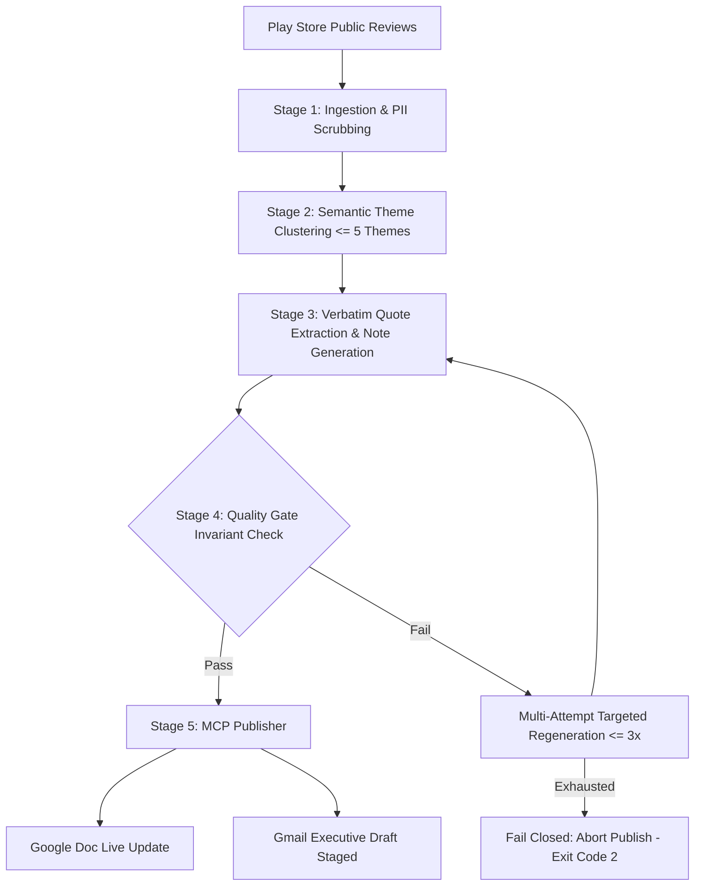

# Groww Weekly Review Pulse

> Automated customer feedback audit, sentiment clustering, and executive reporting engine for **Groww (Stocks, Mutual Fund, IPO)** app store reviews. Synthesizes high-volume Google Play feedback into a verified 90-second executive pulse note delivered via Google Docs and Gmail Model Context Protocol (MCP) servers.

[](file:///D:/VibeCode/Applied%20Generative%20AI%20Bootcamp/groww-weekly-review-pulse/tests)
[](file:///D:/VibeCode/Applied%20Generative%20AI%20Bootcamp/groww-weekly-review-pulse/frontend)
[](file:///D:/VibeCode/Applied%20Generative%20AI%20Bootcamp/groww-weekly-review-pulse/docs/architecture.md)
[](https://groww-weekly-review-pulse-frontend.vercel.app)
[](https://huggingface.co/spaces/deamonizer/groww-weekly-review-pulse-backend)

The **Groww Weekly Review Pulse** pipeline conducts a rigorous weekly audit of public Play Store reviews, applies strict schema validation, monitors core app performance vitals, and enforces privacy guardrails to produce an executive-ready leadership brief without human toil.

---

## 1. Executive Summary & Core Invariants

The engine transforms noisy app feedback into an actionable, 90-second leadership pulse governed by strict algorithmic invariants:

* **Strict Length Ceiling:** Exactly ≤ 250 words total (target: ~210–235 words, 90-second read).
* **Theme Cap:** At most 5 product-relevant themes clustered from semantic vectors; top 3 ranked and reported in the executive summary.
* **Verbatim Customer Quotes:** Exactly 3 quotes copied directly as exact substrings from distinct, eligible user reviews. The LLM never invents, hallucinates, or modifies quote text.
* **Grounded Operational Actions:** Exactly 3 recommended actions, each strictly mapped to one of the top 3 customer friction themes with clear operational ownership.
* **Zero-PII Guarantee:** Multi-layered scrubbing (regex, NLP, PAN/Aadhaar/phone/UPI pattern redaction) ensures no personally identifiable information reaches SQLite, Google Docs, Gmail drafts, or console logs.
* **MCP Publishing (Human-in-the-Loop):** Publishes the validated note to Google Docs and stages an executive draft in Gmail using Model Context Protocol (MCP). **Strictly zero automatic email dispatch.**

---

## 2. Architecture & Pipeline Stages



---

## 3. Installation & Getting Started

### Prerequisites
* Python 3.11+
* Node.js 18+ (for frontend dashboard and MCP server)
* Git

### Step 1: Clone Repository
```bash
git clone https://github.com/Saurabh682/groww-weekly-review-pulse.git
cd groww-weekly-review-pulse
```

### Step 2: Set up Python Virtual Environment
```bash
python -m venv .venv
source .venv/bin/activate  # Windows: .venv\Scripts\activate
pip install -r requirements.txt
```

### Step 3: Install Frontend Dependencies
```bash
cd frontend
npm install
cd ..
```

---

## 4. CLI Orchestration & Workflow Commands

The pipeline is managed through the unified `src.pipeline` CLI:

### Full Pipeline Run
Execute end-to-end ingestion, theme clustering, quote selection, note generation, invariant validation, and MCP publication:
```bash
python -m src.pipeline run --week 2026-11-10
```

### Dry-Run Mode
Execute through validation gate to verify invariants and inspect output note without triggering MCP side-effects:
```bash
python -m src.pipeline run --week 2026-11-10 --dry-run
```

### Stage-Limited Execution & Cached State Resume
Resume from cached intermediate state or run only up to a target pipeline stage:
```bash
python -m src.pipeline run --week 2026-11-10 --stage ingest
python -m src.pipeline run --week 2026-11-10 --stage themes
python -m src.pipeline run --week 2026-11-10 --stage note
```

### Retention & Data Purge
Purge historical review rows and archived raw CSV files older than the rolling window plus one prior window:
```bash
python -m src.pipeline purge --week 2026-11-10 --weeks 18
```

---

## 5. Sample Outputs, Evidence & Reports

### Generated Weekly Pulse Note (`outputs/2026-11-09/note.md`)
```markdown
## Groww Weekly Review Pulse: Week of 09 Nov 2026
Google Play reviews (2026-08-17 to 2026-11-09) • Total: 1,435 • Analyzed: 662 • Avg Rating: 2.7★

Top Themes:
1. Charges & Pricing (31.0% share, 2.6★)
Users report unexpected charges and request transparent fee breakdowns on equity transactions and DP deductions.

2. App Performance & Bugs (28.8% share, 2.4★)
Frequent app lag and freezing reported during peak trading hours (09:15 - 10:30 IST), impacting critical order execution.

3. Positive UX & Simplicity (26.1% share, 3.6★)
Users praise intuitive navigation, clean interface design, and straightforward mutual fund investing and tracking.

Voice of the Customer (Verbatim Quotes):
• "Withdrawal request placed on Monday, still pending on Friday" (1★ review, Charges & Pricing)
• "added USD 216 (21k rupees), 8 days ago and it was never added to my account" (1★ review, App Performance & Bugs)
• "Hi team your nifty terminal lagging in the desktop and everything 20 to 25 minutes auto frezze please resolve this issue" (5★ review, Positive UX & Simplicity)

Recommended Operational Actions:
1. [Charges & Pricing] Deploy in-app fee breakdown calculator and display itemized DP charges on order confirmation screens. (Owner: Core Brokerage Team)
2. [App Performance & Bugs] Conduct load testing on morning market-open websocket channels and patch chart rendering memory leaks. (Owner: Mobile Reliability Team)
3. [Positive UX & Simplicity] Maintain current simplified mutual fund dashboard layout while streamlining advanced equity analytics. (Owner: Product Design Team)
```

### Structured Run Report Output (`outputs/2026-11-09/run_report.json`)
```json
{
  "run_id": "run_2026-11-09_1794547419911",
  "week_start": "2026-11-09",
  "status": "published",
  "dry_run": false,
  "total_reviews": 1435,
  "analyzed_reviews": 662,
  "word_count": 208,
  "is_valid": true,
  "top_themes": [
    { "rank": 1, "label": "Charges & Pricing", "share_pct": 0.31, "avg_rating": 2.6 },
    { "rank": 2, "label": "App Performance & Bugs", "share_pct": 0.288, "avg_rating": 2.4 },
    { "rank": 3, "label": "Positive UX & Simplicity", "share_pct": 0.261, "avg_rating": 3.6 }
  ],
  "quotes_count": 3,
  "actions_count": 3
}
```

---

## 6. MCP Server & Publishing Setup

The pipeline integrates with Google Workspace via the Model Context Protocol (`gmail-docs-mcp`):

* **Google Docs:** Idempotently upserts the live executive document titled `Groww Weekly Review Pulse: Week of YYYY-MM-DD`.
* **Gmail Staging:** Pre-composes the leadership update into your personal Gmail Drafts folder. Does **not** expose or automate sending, maintaining strict human-in-the-loop control.

### Live Artifact Links
* **Live Web Dashboard:** [https://groww-weekly-review-pulse-frontend.vercel.app](https://groww-weekly-review-pulse-frontend.vercel.app)
* **Hugging Face Backend:** [https://huggingface.co/spaces/deamonizer/groww-weekly-review-pulse-backend](https://huggingface.co/spaces/deamonizer/groww-weekly-review-pulse-backend)
* **Live Google Doc:** [https://docs.google.com/document/d/1BPe7HxJWozrCPsyr_xR1LEYDb04mTxFOKSyB340REKE/edit](https://docs.google.com/document/d/1BPe7HxJWozrCPsyr_xR1LEYDb04mTxFOKSyB340REKE/edit)

---

## 7. Verification & Test Suite

The project includes an exhaustive automated test suite covering all phases and edge cases:

### Run Backend Python Tests (147 passing tests)
```bash
pytest
```

### Run Frontend Vitest Tests (21 passing tests)
```bash
cd frontend
npm test -- --run
cd ..
```

### Test Coverage Breakdown
| Phase | Test Suite | Focus Areas | Passing |
|---|---|---|---|
| **Phase 0** | `tests/test_phase0.py` | Config limits, ToS guards, fixture loading | 15 / 15 |
| **Phase 1** | `tests/test_phase1.py` | Allowlist, deduplication, PII regex & NLP scrubbing, language tagging | 42 / 42 |
| **Phase 2** | `tests/test_phase2.py` | Vector embeddings, k-means clustering ≤5 themes, ranking, spike weeks | 23 / 23 |
| **Phase 3** | `tests/test_phase3.py` | Extractive verbatim quotes, 250-word budget trimmer, invariant validator | 22 / 22 |
| **Phase 4** | `tests/test_phase4.py` | MCP client contract, idempotency hash, partial-failure resume | 25 / 25 |
| **Phase 5** | `tests/test_phase5.py` | Orchestration, dry-run, crash recovery, retention purge, canary tests | 20 / 20 |
| **Frontend** | `frontend/tests/` | UI screens, word counter, PII check, draft safety (strictly no send) | 21 / 21 |
| **Total** | | **Comprehensive multi-layer test coverage** | **168 / 168** |

---

## 8. Contributing, Issues & Community Support

We welcome contributions, bug reports, and feedback from the community!

* **Report Bugs:** Open an issue via the [GitHub Issue Tracker](https://github.com/Saurabh682/groww-weekly-review-pulse/issues).
* **Feature Requests:** Submit ideas and enhancement proposals in [GitHub Discussions](https://github.com/Saurabh682/groww-weekly-review-pulse/discussions).
* **Pull Requests:** 
  1. Fork the repository and create your branch (`git checkout -b feature/improvement`).
  2. Ensure all 168 tests pass (`pytest` and `npm test`).
  3. Commit your changes with clear messages (`git commit -m "feat: add capability"`).
  4. Open a pull request against the `main` branch.

---

## 9. License & Compliance

Distributed under the MIT License. See `LICENSE` for more information.

This project processes **publicly available** user reviews strictly for product quality enhancement and customer experience analysis. It adheres to zero-PII data minimization principles and complies with Google Play Store review export guidelines.
