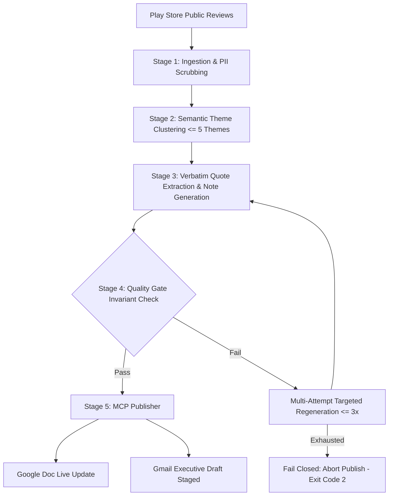

# Groww Weekly Review Pulse

> Turn raw app-store feedback for **Groww (Stocks, Mutual Fund, IPO)** into an executive-grade weekly pulse note that product teams and leadership can scan in 90 seconds: what users care about, verbatim customer quotes, and concrete operational actions.

[](file:///D:/VibeCode/Applied%20Generative%20AI%20Bootcamp/groww-weekly-review-pulse/tests)
[](file:///D:/VibeCode/Applied%20Generative%20AI%20Bootcamp/groww-weekly-review-pulse/frontend)
[](file:///D:/VibeCode/Applied%20Generative%20AI%20Bootcamp/groww-weekly-review-pulse/docs/architecture.md)
[](https://groww-weekly-review-pulse-frontend.vercel.app)
[](https://huggingface.co/spaces/deamonizer/groww-weekly-review-pulse-backend)

---

## 1. Executive Summary & Core Invariants

The Groww Weekly Review Pulse synthesizes public Google Play reviews across rolling 8–12 week windows into a strictly bounded executive digest. Every generated note is verified against hard algorithmic gates:

1. **Strict Length Ceiling:** Exactly ≤ 250 words total (target: ~210–235 words, 90-second read).
2. **Theme Cap:** At most 5 product-relevant themes clustered from semantic vectors, top 3 ranked and reported in the executive summary.
3. **Verbatim Customer Quotes:** Exactly 3 quotes copied directly as exact substrings from distinct, eligible user reviews. The LLM never invents, hallucinates, or modifies quote text.
4. **Grounded Operational Actions:** Exactly 3 recommended actions, each strictly mapped to one of the top 3 customer friction themes with clear operational ownership.
5. **Zero-PII Guarantee:** Multi-layered scrubbing (regex, NLP, PAN/Aadhaar/phone/UPI pattern redaction) ensures no personally identifiable information reaches SQLite, Google Docs, Gmail drafts, or console logs.
6. **MCP Publishing (Human-in-the-Loop):** Publishes the validated note to Google Docs and stages an executive draft in Gmail using Model Context Protocol (MCP). **Strictly zero automatic email dispatch.**

---

## 2. Architecture & Pipeline Stages



---

## 3. Quick Start & CLI Usage

### Prerequisites
- Python 3.11+
- Node.js 18+ (for frontend and MCP server)

### Installation
```bash
git clone https://github.com/Saurabh682/groww-weekly-review-pulse.git
cd groww-weekly-review-pulse
python -m venv .venv
source .venv/bin/activate  # Or on Windows: .venv\Scripts\activate
pip install -r requirements.txt
```

### Running the Orchestrator (`pulse run`)
Run the entire end-to-end pipeline for a given week:
```bash
# Full execution (Ingest -> Themes -> Note -> Validate -> Publish)
python -m src.pipeline run --week 2026-11-10

# Dry-run mode (runs through validation gate, skips MCP publishing)
python -m src.pipeline run --week 2026-11-10 --dry-run

# Stage execution / resume from cache
python -m src.pipeline run --week 2026-11-10 --stage ingest
python -m src.pipeline run --week 2026-11-10 --stage themes
python -m src.pipeline run --week 2026-11-10 --stage note

# Retention purge (removes reviews and raw files older than rolling window + 1 prior window)
python -m src.pipeline purge --week 2026-11-10 --weeks 18
```

---

## 4. MCP Server & Publishing Setup

The pipeline interfaces with Google Workspace via the dedicated `gmail-docs-mcp` server:

- **Google Docs**: Idempotently creates or updates the live document titled `Groww Weekly Review Pulse: Week of YYYY-MM-DD`.
- **Gmail Draft**: Stages an executive email in the user's Gmail Drafts folder. Does **not** expose a `send_mail` tool, ensuring leadership always reviews before manual dispatch.

### Live Links & Artifacts
- **Live Frontend**: [https://groww-weekly-review-pulse-frontend.vercel.app](https://groww-weekly-review-pulse-frontend.vercel.app)
- **Hugging Face Backend Space**: [https://huggingface.co/spaces/deamonizer/groww-weekly-review-pulse-backend](https://huggingface.co/spaces/deamonizer/groww-weekly-review-pulse-backend)
- **Live Google Doc**: [Groww Weekly Review Pulse: Week of 09 Nov 2026](https://docs.google.com/document/d/1BPe7HxJWozrCPsyr_xR1LEYDb04mTxFOKSyB340REKE/edit)

---

## 5. Verification & Test Suite

The project includes a comprehensive test suite covering all phases and cross-cutting invariants:

```bash
# Run backend Python tests (147 passing tests)
pytest

# Run frontend Vitest tests (21 passing tests)
cd frontend
npm test -- --run
```

| Phase | Test Suite | Focus Areas | Passing |
|---|---|---|---|
| **Phase 0** | `tests/test_phase0.py` | Config limits, ToS guards, fixture loading | 15 / 15 |
| **Phase 1** | `tests/test_phase1.py` | Allowlist, deduplication, PII regex & NLP scrubbing, language tagging | 42 / 42 |
| **Phase 2** | `tests/test_phase2.py` | Vector embeddings, k-means clustering ≤5 themes, ranking, spike weeks | 23 / 23 |
| **Phase 3** | `tests/test_phase3.py` | Extractive verbatim quotes, 250-word budget trimmer, invariant validator | 22 / 22 |
| **Phase 4** | `tests/test_phase4.py` | MCP client contract, idempotency hash, partial-failure resume | 25 / 25 |
| **Phase 5** | `tests/test_phase5.py` | Orchestration, dry-run, crash recovery, retention purge, canary tests | 20 / 20 |
| **Frontend** | `frontend/tests/` | UI screens, word counter, PII check, draft safety (strictly no send) | 21 / 21 |
| **Total** | | **Comprehensive multi-layer test coverage** | **168 / 168** |

---

## 6. Project Layout

```
groww-weekly-review-pulse/
├── README.md                 # Project root documentation & guide
├── pyproject.toml            # Dependencies and pytest configuration
├── docs/                     # System design, ADRs, requirements & edge-case matrix
│   ├── architecture.md       # Full architecture specification
│   ├── implementation-plan.md# Phase-wise tracking and acceptance criteria
│   └── edge-case.md          # 100+ edge-case test definitions (ORC, PII, INV, THM, MCP)
├── gmail-docs-mcp/           # Dedicated MCP Server (Google Docs + Gmail draft staging)
├── src/
│   ├── pipeline.py           # Unified orchestrator (pulse run, pulse purge)
│   ├── ingest/               # Google Play review CSV importers
│   ├── clean/                # Normalization, deduplication, PII scrubbing (zero-PII)
│   ├── themes/               # Semantic clustering, labeling, priority ranking
│   ├── note/                 # Word budget enforcement, quote selection, validation gate
│   ├── mcp/                  # MCP client, capabilities resolver, publisher
│   └── store/                # SQLite storage (runs, reviews, themes, publish_state, retention)
├── frontend/                 # Production React + Vite dashboard
│   ├── src/features/pulse/   # Weekly Pulse executive view
│   ├── src/features/themes/  # Theme distribution & radar
│   ├── src/features/run/     # Run & publish heartbeat & validation matrix
│   ├── src/features/import/  # Data import & coverage diagnostics
│   └── src/features/help/    # Comprehensive expandable Help & Feature Guide
├── outputs/                  # Local copies of generated notes and run reports
└── tests/                    # 147 automated Python unit, property, and invariant tests
```

---

## 7. License & Compliance
This project processes **publicly available** user reviews strictly for product quality enhancement and customer experience analysis. It adheres to zero-PII data minimization principles and complies with Google Play Store review export guidelines.
