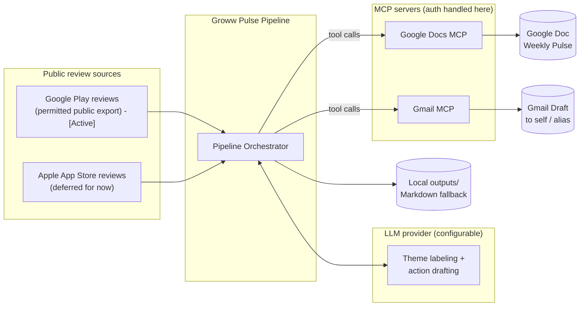
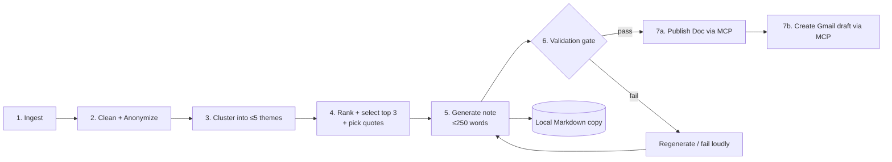
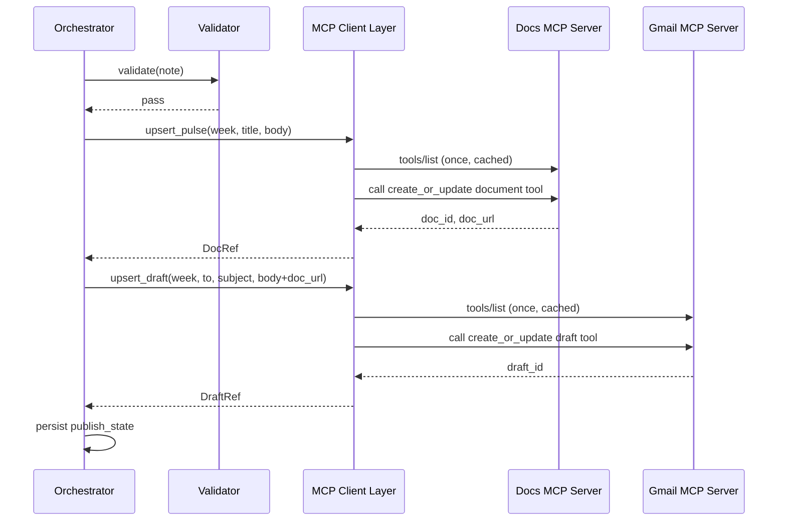

# Architecture: Groww Weekly Review Pulse

> Companion to `problemStatement.md`. This document defines *how* the system is built: components, data flow, data model, algorithms, MCP integration, privacy controls, testing, and delivery plan.

**Status:** Draft v1  |  **Scope:** Weekly pipeline that turns public Groww app-store reviews into a one-page pulse (Google Docs) and a Gmail draft, both via MCP.  
> **Scope Note (Current):** Ingestion is focused exclusively on **Google Play Store**. Apple App Store ingestion is deferred for future iterations.

---

## 1. Goals Recap (from the problem statement)

| # | Requirement | Architectural consequence |
|---|---|---|
| R1 | Import public reviews from roughly the last 8-12 weeks | Pluggable `ReviewSource` adapters; compliant-by-default sources; windowed, deduplicated local store |
| R2 | Cluster into **≤ 5 themes** | Clustering engine with a hard cap enforced in code, not just in prompts |
| R3 | One-page note: top 3 themes, 3 verbatim quotes, 3 actions, **≤ 250 words** | Constrained, schema-driven generation plus a validation gate |
| R4 | Publish to **Google Docs** and create a **Gmail draft** via **MCP** | `Publisher` layer talking only to MCP tools; no Google OAuth/REST code |
| R5 | **No PII** in any artifact | Allowlist ingestion, layered scrubbing, PII gate before any publish |
| R6 | Quotes are real, verbatim | Extractive quote selection plus an automated verbatim check |

---

## 2. Architectural Principles

1. **MCP-first integration.** The app never holds Google credentials. Auth lives in the MCP server/host configuration; the app only calls tools.
2. **Privacy by construction.** Reviewer-identifying fields are dropped at the boundary and never enter the data model. Scrubbing is a pipeline stage, not an afterthought.
3. **Deterministic where it matters.** Counts, ranking, quote extraction, word-count, and PII checks are plain code. The LLM is used only for labeling themes and drafting action ideas, under a strict output schema.
4. **Fail closed.** If any validation fails, nothing is published. Local Markdown output is always produced as a fallback.
5. **Idempotent weekly runs.** Re-running a week updates the same Doc and draft instead of creating duplicates.
6. **Small and legible.** A linear pipeline of single-purpose stages, each independently testable.

---

## 3. System Context



**Actors:** Operator (runs or schedules the pipeline) and stakeholders (Product/Growth, Support, Leadership) who read the Doc and the email.

---

## 4. High-Level Pipeline



| Stage | Input | Output | Deterministic? |
|---|---|---|---|
| 1. Ingest | Source config, window | Raw review records (no reviewer identity) | Yes |
| 2. Clean + Anonymize | Raw reviews | Normalized, deduped, PII-scrubbed reviews + `quote_eligible` flag | Yes |
| 3. Cluster | Clean reviews | Theme assignments (≤5), theme stats | Mostly (seeded); LLM for labels |
| 4. Rank + Select | Themes, reviews | Top 3 themes, 3 quote candidates | Yes |
| 5. Generate | Top themes, quotes, stats | Note (structured → Markdown) | LLM for action ideas and summaries only |
| 6. Validate | Note + dataset | Pass/fail with reasons | Yes |
| 7. Publish | Valid note | Doc URL, Draft ID | Yes (via MCP) |

---

## 5. Component Design

### 5.1 Ingestion (`src/ingest/`)

Interface:

```python
class ReviewSource(Protocol):
    name: str  # "play_store" | "app_store" | ...
    def fetch(self, window_start: date, window_end: date) -> Iterable[RawReview]: ...
```

`RawReview` contains **only** allowlisted fields: `platform, rating, title, text, date, app_version, country/language (optional)`. Reviewer name, avatar, user ID, and any other identity fields are **never read into the object**; adapters map from the source payload using an explicit allowlist, not a blacklist.

**Adapters**

| Adapter | Source | Status / Notes |
|---|---|---|
| `PlayStoreExportSource` | Permitted public export of Groww's Play Store reviews | **Active**: Google Play has no public API for third-party review retrieval. Default implementation is a **CSV/JSON import adapter** for a manually exported public dataset. Any automated collection must be reviewed against Play's ToS before enabling, and sits behind a feature flag (off by default). |
| `CsvImportSource` | Local CSV/JSON | **Active**: Generic fallback for Play Store review exports; column mapping in config |
| `AppStoreFeedSource` | Apple's public customer-reviews feed for the Groww iOS app | **Deferred**: Apple App Store integration is deferred for now to focus entirely on Google Play Store. |

Play Store URL for the Groww listing: `https://play.google.com/store/apps/details?id=com.nextbillion.groww&hl=en_IN`

**Responsibilities:** pagination/rate limiting with polite delays, window filtering (default 12 weeks, minimum 8), retries with backoff, and writing raw responses to `data/raw/` *after* allowlist mapping (so raw files are PII-free too).

### 5.2 Cleaning and Privacy (`src/clean/`)

Ordered sub-steps:

1. **Normalize:** Unicode NFKC, whitespace collapse, strip control chars, consistent date to UTC date.
2. **Language detect:** tag `lang` (en, hi, hinglish/mixed, other). Non-English reviews are kept for clustering if a multilingual embedder is used; they are `quote_eligible = false` by default unless the quote is verbatim in the original script and PII-clean.
3. **Dedupe:** key = `sha256(platform | date | normalized_text)`; near-duplicate collapse using MinHash/shingling (threshold configurable).
4. **Spam/low-info filter:** drop empty reviews; mark reviews under N tokens (default 3) as `low_info` and exclude from clustering and quotes (still counted in total volume and average rating).
5. **PII scrub (layered, see §9):** detect, then **redact in stored text** and flag `quote_eligible = false` if any PII was found.

Output: normalized review rows persisted to SQLite (§6).

### 5.3 Theme Engine (`src/themes/`)

Hybrid design for reproducibility plus readable labels (details in §7):

- **Embed** review text (local sentence-embedding model by default; provider-pluggable).
- **Cluster** with a method whose cluster count is **capped at 5** (e.g., KMeans with k chosen in [3, 5] by silhouette score, or agglomerative with `max_clusters=5`). Any "noise" or tiny clusters are merged into the nearest cluster or placed in an `Other` bucket that **counts against the 5-theme cap**.
- **Label** each cluster with the LLM from representative reviews (nearest-to-centroid sample). Output schema: `{label, description}`. Labels must be short (≤4 words).
- **Stats** computed in code: `review_count, share_pct, avg_rating, neg_share, trend_vs_prior_week`.

### 5.4 Ranking and Selection (`src/note/select.py`)

- Compute a `priority_score` per theme (§7.3) and take the top 3.
- Select **3 quote candidates** extractively (§8.2), preferring one per top theme.

### 5.5 Note Generator (`src/note/`)

- Builds a **structured note object** (not free text) from computed facts.
- Calls the LLM only for: one-line theme summaries and the three action ideas, with a JSON schema and per-field word limits.
- Renders the final Markdown from a template. Rendering is code; wording inside fields is LLM.
- Enforces the **≤ 250-word budget** (§8.3).

### 5.6 Validator (`src/note/validate.py`)

Blocking checks run before any publish:

| Check | Rule |
|---|---|
| Word count | ≤ 250 words total in the rendered note |
| Structure | Exactly 3 themes, 3 quotes, 3 actions |
| Theme cap | Total distinct themes in the run ≤ 5 |
| Quote verbatim | Each quote is a (normalized) substring of its source review's stored text |
| Quote uniqueness | 3 distinct source reviews |
| PII scan | No emails, phones, IDs, usernames, URLs-with-handles in note, subject, or body |
| Grounding | Each action references a top-3 theme |

On failure: targeted regeneration (max N attempts), then fail loudly with a report. Nothing is published on failure.

### 5.7 Publisher (`src/mcp/`)

Thin MCP client layer exposing two domain-level interfaces:

```python
class DocsPublisher:
    def upsert_pulse(self, week_start: date, title: str, body_md: str) -> DocRef: ...

class DraftPublisher:
    def upsert_draft(self, week_start: date, to: str, subject: str, body: str) -> DraftRef: ...
```

Implementations discover and call MCP tools at runtime (see §10). No Google SDKs or REST clients are imported anywhere in the codebase.

### 5.8 Orchestrator and CLI (`src/pipeline.py`)

- `pulse run --week 2026-11-09` runs all stages and publishes.
- `pulse run --dry-run` runs through validation and writes local Markdown only.
- `pulse run --stage cluster` re-runs from a stage using cached intermediate data.
- Reads config, assigns a `run_id`, records stage status in the `runs` table, and handles retries and fallbacks.

---

## 6. Data Architecture

**Storage:** SQLite file (`data/pulse.db`) for simplicity and portability, plus flat files for raw and output artifacts. Everything stored is PII-free by design.

```sql
CREATE TABLE reviews (
  review_id      TEXT PRIMARY KEY,      -- sha256(platform|date|normalized_text), truncated
  platform       TEXT NOT NULL,         -- 'play_store' | 'app_store'
  rating         INTEGER NOT NULL CHECK (rating BETWEEN 1 AND 5),
  title          TEXT,
  text           TEXT NOT NULL,         -- normalized + PII-redacted
  review_date    DATE NOT NULL,
  app_version    TEXT,
  lang           TEXT,
  low_info       INTEGER DEFAULT 0,
  pii_found      INTEGER DEFAULT 0,     -- PII was detected and redacted
  quote_eligible INTEGER DEFAULT 1,
  sentiment      TEXT,                  -- 'neg' | 'neu' | 'pos' (optional)
  ingested_at    TIMESTAMP NOT NULL
);

CREATE TABLE runs (
  run_id         TEXT PRIMARY KEY,
  week_start     DATE NOT NULL,
  window_start   DATE NOT NULL,
  window_end     DATE NOT NULL,
  status         TEXT NOT NULL,         -- 'running' | 'validated' | 'published' | 'failed'
  error          TEXT,
  started_at     TIMESTAMP NOT NULL,
  finished_at    TIMESTAMP
);

CREATE TABLE review_themes (            -- assignment per run (themes can change week to week)
  run_id         TEXT NOT NULL,
  review_id      TEXT NOT NULL,
  theme_id       TEXT NOT NULL,
  distance       REAL,
  PRIMARY KEY (run_id, review_id)
);

CREATE TABLE themes (
  run_id         TEXT NOT NULL,
  theme_id       TEXT NOT NULL,
  label          TEXT NOT NULL,
  description    TEXT,
  review_count   INTEGER NOT NULL,
  share_pct      REAL NOT NULL,
  avg_rating     REAL NOT NULL,
  neg_share      REAL NOT NULL,
  priority_score REAL NOT NULL,
  rank           INTEGER,
  PRIMARY KEY (run_id, theme_id)
);

CREATE TABLE publish_state (            -- idempotency anchor
  week_start     DATE PRIMARY KEY,
  doc_id         TEXT,
  doc_url        TEXT,
  draft_id       TEXT,
  content_hash   TEXT,
  updated_at     TIMESTAMP
);
```

**Retention:** keep processed reviews for the rolling window plus the prior window (for week-over-week trend); purge older rows. Raw files are PII-free but still pruned on the same schedule.

---

## 7. Theme Clustering Design

### 7.1 Method

1. Build the input text as `title + ". " + text` for non-low-info reviews.
2. Embed with a multilingual sentence-embedding model (handles English and Hinglish reasonably).
3. Reduce dimensionality if needed (e.g., UMAP/PCA) for stability.
4. Cluster with a **cap of 5**: try k = 3..5, choose by silhouette (ties go to the larger k only if each cluster ≥ 5% of reviews).
5. Merge any cluster under a minimum size (default 3% of reviews) into its nearest neighbor.
6. Fix the random seed and persist cluster assignments for reproducibility.

### 7.2 Labeling

For each cluster, send the LLM ~15 representative reviews (closest to centroid) plus ~5 diverse outliers and request:

```json
{ "label": "<≤4 words>", "description": "<≤15 words>" }
```

A **domain hint list** (onboarding/KYC, payments/UPI, withdrawals, app stability/login, statements/reports, charges, support, positive UX) is provided as optional vocabulary so labels are consistent from week to week, but the LLM may choose other labels if the data demands it.

### 7.3 Ranking

```
neg_share      = share of reviews in theme with rating <= 2
priority_score = share_pct * (0.6 + 0.4 * neg_share)
```

Volume dominates, with a boost for severity. Weights are configurable. A positive-heavy theme can still make the top 3 on volume, which keeps the pulse balanced. Ties break by higher `neg_share`, then by week-over-week growth.

### 7.4 Stability Across Weeks

To keep week-to-week labels comparable, the engine reuses the previous run's theme labels when a new cluster's centroid cosine similarity to an old theme exceeds a threshold (default 0.85). Otherwise a new label is generated.

---

## 8. Note Generation Design

### 8.1 Structured Intermediate

```json
{
  "window": {"start": "...", "end": "..."},
  "total_reviews": 0,
  "avg_rating": 0.0,
  "themes": [
    {"label": "", "share_pct": 0, "avg_rating": 0.0, "summary": ""}
  ],
  "quotes": [
    {"review_id": "", "theme": "", "text": ""}
  ],
  "actions": [
    {"theme": "", "text": ""}
  ]
}
```

### 8.2 Quote Selection (Extractive, Verbatim by Construction)

1. Candidate pool: reviews in the top-3 themes with `quote_eligible = 1`, `low_info = 0`, and `lang = en` (unless configured otherwise).
2. Split each candidate into sentences; keep sentences of 6-22 words.
3. Score by closeness to theme centroid, specificity (mentions a concrete issue or feature), and rating polarity matching the theme tone.
4. Choose 3 quotes from 3 distinct reviews, covering as many distinct top themes as possible.
5. **The LLM never writes quote text.** At most it picks among pre-extracted candidate IDs. The code copies the exact sentence span from the stored text.
6. Optional ellipsis only between exact fragments of one review; never inside a fragment.

### 8.3 Word Budget (≤ 250 words)

| Section | Budget |
|---|---|
| Title + window line | ≤ 20 |
| Top 3 themes (3 × ≤ 22) | ≤ 66 |
| 3 quotes (3 × ≤ 22) | ≤ 66 |
| 3 actions (3 × ≤ 30) | ≤ 90 |
| Slack | ~8 |

The prompt carries these limits; the validator counts words on the final rendered text (excluding Markdown syntax). If over budget, the generator re-prompts the over-limit field only, then falls back to deterministic truncation of the lowest-priority sentence.

### 8.4 Action Ideas

Each action takes the form: **Theme → specific change/investigation → owner function → success signal.** Example shape (illustrative only):

> *Payments:* Audit UPI add-funds failure paths in the latest release. Owner: Engineering. Target: fewer failure-related reviews next week.

The LLM is given only the computed theme facts and the chosen quotes, so actions stay grounded and do not invent causes.

---

## 9. Privacy and PII Architecture

Defense in depth across five layers:

| Layer | Control |
|---|---|
| **L1: Boundary allowlist** | Adapters map only allowlisted fields. Reviewer names, IDs, avatars, and URLs never enter memory structures or raw files. |
| **L2: Text scrubbing** | Regex plus optional NER to detect and redact emails, phone numbers (including Indian formats), PAN/Aadhaar-like patterns, UPI IDs, account/folio/order/transaction numbers, URLs, and @handles. Redacted tokens become `[REDACTED]`. |
| **L3: Quote eligibility** | Any review with PII detected is `quote_eligible = false`. Sign-offs containing names ("Thanks, <name>") are detected by heuristics and excluded. |
| **L4: Pre-publish PII gate** | Final note, email subject, and body re-scanned by the same detectors. Any hit blocks publish. |
| **L5: Log hygiene** | Logs store IDs, counts, and timings only, never review text. LLM prompts/responses are not logged by default. |

**LLM data handling:** only scrubbed text is sent to the LLM provider. Provider choice and retention settings are documented in the README.

**Secrets:** none required by the app for Google. LLM API keys, if any, come from environment variables, never committed.

---

## 10. MCP Integration Architecture

### 10.1 Pattern



### 10.2 Tool Binding

MCP tool names and argument schemas differ by server. The client layer therefore:

1. Calls `tools/list` at startup and caches the schema.
2. Resolves each **capability** (`docs.create`, `docs.update`, `gmail.create_draft`, optionally `docs.search`, `gmail.update_draft`) to a concrete tool via a small mapping in `config/mcp.yaml`, with name-based fuzzy fallback.
3. Fails fast with a clear message if a required capability is missing.

Capability map (illustrative; confirm against the actual servers chosen):

| Capability | Needed for | Required? |
|---|---|---|
| `docs.create` | First publish of a week | Yes |
| `docs.update` / replace content | Re-runs for same week | Preferred (else create a new versioned doc) |
| `gmail.create_draft` | Draft email | Yes |
| `gmail.update_draft` | Re-runs | Preferred (else create a new draft with a revision suffix) |

### 10.3 Idempotency

- `publish_state` stores `doc_id` and `draft_id` per `week_start`, plus a `content_hash` of the note.
- Same hash → skip (no-op). New hash → update in place when the server supports it; otherwise create a versioned doc (`... v2`) and note it in the draft.
- Draft is **never sent** by the pipeline. It is created and left for the human to review.

### 10.4 Email Content

- **To:** configured self address or alias.
- **Subject:** `Groww Weekly Review Pulse | Week of YYYY-MM-DD`
- **Body:** the full note (plain text/HTML rendering) plus the Doc link. If the full note would break the 250-word rule when combined with extra copy, the body contains the note unchanged and only a one-line link footer.

### 10.5 Failure Handling

| Failure | Behavior |
|---|---|
| MCP server unreachable / timeout | Retry with exponential backoff (3 attempts), then mark run `failed` and keep local Markdown |
| Auth expired in MCP host | Surface actionable error ("re-authorize Docs/Gmail MCP connector"); no credential handling in app |
| Docs succeeds, Gmail fails | Persist doc state; re-run resumes at the Gmail step only |
| Missing capability | Fail before publishing anything |

---

## 11. Configuration

`config/pulse.yaml`

```yaml
app:
  name: Groww
  play_store_id: com.nextbillion.groww
  app_store_id: "<numeric id>"        # fill in
  region: in
window:
  weeks: 12                           # min 8, max 12
sources:
  app_store: { enabled: true }
  play_store:
    mode: csv_import                  # csv_import | automated (disabled by default)
    path: data/imports/play_reviews.csv
themes:
  max_themes: 5
  min_cluster_share: 0.03
  top_n: 3
note:
  max_words: 250
  quotes: 3
  actions: 3
llm:
  provider: "<configurable>"
  model: "<configurable>"
  temperature: 0.2
email:
  to: "<self or alias>"
mcp:
  config: config/mcp.yaml
```

---

## 12. Observability and Operations

- **Structured logs:** `run_id`, stage, counts, durations, validation results. No review text.
- **Run report:** `outputs/<week>/run_report.json` with review counts per source, theme stats, validator outcomes, MCP call results.
- **Metrics (optional):** reviews ingested, % redacted, theme sizes, regeneration attempts.
- **Scheduling:** weekly trigger via cron, a scheduled CI workflow, or a manual command. Execution host must have access to the configured MCP servers and their authorized sessions.

---

## 13. Testing Strategy

| Level | What | Examples |
|---|---|---|
| **Unit** | Pure functions | PII regexes (positive and negative cases), dedupe keys, word counter, ranking formula, sentence extraction |
| **Property/Invariant** | Hard rules | `themes ≤ 5`, `quotes == 3`, `actions == 3`, `words ≤ 250` for any input |
| **Golden/Fixture** | End-to-end on a small anonymized fixture dataset | Expected themes stable under fixed seed; note snapshot test |
| **Verbatim test** | Every quote is a substring of source text | Fails if the LLM or renderer alters text |
| **PII gate test** | Seeded fake PII in fixtures never reaches output | Includes emails, phone numbers, PAN-like strings, UPI IDs, names in sign-offs |
| **MCP contract test** | Mock MCP server | Create, update, retry, missing-capability, partial failure resume |
| **Idempotency test** | Run twice for same week | One Doc, one draft, or clean versioning |
| **Manual smoke** | Real MCP connectors in a sandbox account | Doc renders correctly; draft appears in Drafts |

---

## 14. Repository Layout

```
groww-review-pulse/
├── README.md
├── problemStatement.md
├── architecture.md
├── config/
│   ├── pulse.yaml
│   └── mcp.yaml                  # capability -> tool mapping (no secrets)
├── data/
│   ├── imports/                  # manually exported public review files
│   ├── raw/                      # allowlisted, PII-free source payloads
│   └── pulse.db                  # SQLite
├── src/
│   ├── ingest/                   # app_store_feed.py, play_csv.py, base.py
│   ├── clean/                    # normalize.py, dedupe.py, pii.py, lang.py
│   ├── themes/                   # embed.py, cluster.py, label.py, rank.py
│   ├── note/                     # select.py, generate.py, render.py, validate.py
│   ├── mcp/                      # client.py, docs.py, gmail.py, capabilities.py
│   ├── store/                    # db.py, models.py
│   └── pipeline.py               # orchestration + CLI
├── prompts/                      # label.md, summarize.md, actions.md
├── tests/
│   ├── fixtures/
│   └── ...
└── outputs/
    └── YYYY-MM-DD/               # note.md, run_report.json
```

**Technology choices (default, swappable):** Python 3.11+, SQLite, `sentence-transformers` or a hosted embedding API, `scikit-learn` for clustering, the official MCP client SDK, `pytest`. A TypeScript implementation using the MCP TypeScript SDK would follow the same module boundaries.

---

## 15. Delivery Plan

| Milestone | Scope | Exit criteria |
|---|---|---|
| **M1: Data in** | Ingestion adapters, normalization, dedupe, SQLite, PII scrubber | 8-12 week PII-free dataset loads; PII tests green |
| **M2: Themes** | Embedding, capped clustering, labeling, stats, ranking | ≤5 themes with metrics; deterministic under seed |
| **M3: Note** | Quote extraction, structured generation, renderer, validator | Note ≤250 words; verbatim and PII checks pass |
| **M4: MCP publish** | Docs upsert, Gmail draft, state table, retries | Doc and draft created in sandbox; rerun is idempotent |
| **M5: Hardening** | Scheduling, run report, README, edge cases, full test suite | All acceptance criteria in `problemStatement.md` met |

---

## 16. Risks and Mitigations

| Risk | Impact | Mitigation |
|---|---|---|
| No official public API for Play Store reviews | Data gap or ToS exposure | CSV/JSON import adapter as the default; automated collection off by default and gated on a ToS review |
| App Store feed returns limited depth | Window shorter than 8 weeks | Detect and flag short windows in the note; combine with imports |
| LLM alters or invents quotes | Violates verbatim rule | Extractive quotes plus substring validator; LLM cannot author quote text |
| PII leaks via review body | Privacy violation | Layered scrubbing, quote eligibility flag, pre-publish gate, redacted storage |
| Hinglish / mixed-script reviews cluster poorly | Weak themes | Multilingual embeddings; language-aware quote filtering; manual review of labels in early weeks |
| Theme drift week to week | Hard to compare | Label reuse via centroid similarity |
| MCP tool schemas vary by server | Integration breakage | Capability map plus `tools/list` discovery and contract tests |
| 250-word limit conflicts with rich content | Over-long notes | Per-section budgets and automated trimming; detail lives in `run_report.json`, not the note |
| Re-runs create duplicate Docs/drafts | Clutter and confusion | `publish_state` plus content hashing |

---

## 17. Key Decisions (ADR Summary)

| # | Decision | Rationale | Alternatives |
|---|---|---|---|
| ADR-1 | MCP for Docs and Gmail only | Required by problem statement; removes OAuth/REST code | Direct Google APIs (rejected) |
| ADR-2 | Extractive, code-copied quotes | Guarantees verbatim | LLM-written quotes (rejected) |
| ADR-3 | Hybrid clustering (embeddings + LLM labels) | Reproducible grouping with readable labels | LLM-only classification; pure keywords |
| ADR-4 | SQLite + flat files | Zero-ops, portable, PII-free by schema | Postgres (overkill for weekly batch) |
| ADR-5 | Validation gate blocks publish | Enforces hard constraints (≤250 words, PII, verbatim) | Warn-only |
| ADR-6 | Draft only, never auto-send | Human review before distribution | Auto-send |
| ADR-7 | CSV import as the default Play Store path | Stays within public-export constraint | Automated scraping (off by default) |
| ADR-8 | Focus exclusively on Google Play Store | Simplifies initial scope and ingestion pipeline | Dual-store ingestion (Apple App Store deferred) |

---

## 18. Open Items

- Confirm the compliant public export method for Play Store reviews and its limits.
- *(Deferred)* Provide the Groww iOS App Store numeric ID for the feed adapter.
- Choose the embedding model and LLM provider (and confirm data-handling terms).
- Choose and configure the Docs and Gmail MCP servers; confirm update vs create-only support.
- Decide the draft recipient (personal address or team alias).
- Decide the run trigger: manual command or scheduled job, and where it runs.

---

## 19. Requirements Traceability

| Problem-statement requirement | Where addressed |
|---|---|
| Import last 8-12 weeks of public reviews | §5.1, §11 (`window.weeks`) |
| ≤ 5 themes | §5.3, §7.1, validator §5.6 |
| Top 3 themes in note | §5.4, §7.3 |
| 3 verbatim user quotes | §5.4, §8.2, validator §5.6 |
| 3 action ideas | §8.4, validator §5.6 |
| ≤ 250 words | §8.3, validator §5.6 |
| Note in Google Docs via MCP | §5.7, §10 |
| Gmail draft via MCP | §5.7, §10.4 |
| No PII in any artifact | §5.2, §9 |
| Public exports only, no ToS-violating automation | §5.1, §16, ADR-7 |
| No direct Google API integration | §2, §10, ADR-1 |
