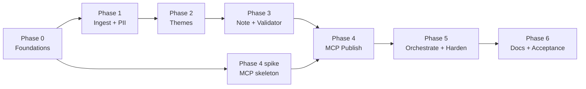

# Implementation Plan: Groww Weekly Review Pulse

> Phase-wise build plan derived from `problemStatement.md` and `architecture.md`.
> **Scope change for this plan: Apple App Store is excluded.** Google Play Store is the only review source for now.

**Status:** Draft v1  |  **Target app:** Groww (`com.nextbillion.groww`)  |  **Sources:** Google Play only

---

## 1. Scope Adjustments from `architecture.md`

Excluding the App Store simplifies ingestion and removes one dependency. Everything else in the architecture stands.

| Architecture item | Change in this plan |
|---|---|
| `AppStoreFeedSource` adapter (§5.1) | **Not built.** Deferred to a future phase. |
| `app_store_id` in config (§11) | **Removed** from the active config; `sources.app_store.enabled: false` kept as a placeholder. |
| `platform` column / enum | **Kept** (`play_store` only for now) so adding a source later needs no schema migration. |
| Open item: "provide App Store numeric ID" | **Dropped.** |
| Cross-store dedupe logic | Reduced to **within-Play dedupe** only. |
| Risk: App Store feed depth limits | **Not applicable.** The Play data-source risk becomes the single critical-path risk. |
| Note wording | Window line and stats say "Google Play reviews" rather than "App Store + Play Store". |

Unchanged: ≤5 themes, top 3 in note, 3 verbatim quotes, 3 actions, ≤250 words, no PII, Docs and Gmail via MCP only, draft never sent.

---

## 2. Guiding Strategy

1. **Walking skeleton first.** Get a trivial end-to-end path (fixture data → note → Google Doc → Gmail draft via MCP) working early, then deepen each stage. This de-risks MCP integration, the least predictable part.
2. **Critical-path risk first.** The Play Store data source must be decided in Phase 0, because every later phase depends on real data.
3. **Gates before features.** The validator (word count, verbatim quotes, PII) is built before polishing generation, so quality rules are enforced from the first real note.
4. **Every phase ends with a demonstrable exit criterion** and a green test suite for that phase.

---

## 3. Phase Overview

| Phase | Name | Goal | Est. effort |
|---|---|---|---|
| **0** | Foundations and decisions | Repo, config, data-source decision, MCP spike, walking skeleton | 1.5-2 days |
| **1** | Ingestion, cleaning, PII | Clean, PII-free Play Store dataset in SQLite | 2-3 days |
| **2** | Theme engine | ≤5 labeled, ranked themes with stats | 2-3 days |
| **3** | Note generation and validation | ≤250-word note with verbatim quotes, passing the gate | 2-3 days |
| **4** | MCP publishing | Idempotent Google Doc and Gmail draft | 1.5-2 days |
| **5** | Orchestration and hardening | One-command weekly run, scheduling, edge cases | 1.5-2 days |
| **6** | Docs, acceptance, handoff | README, demo, acceptance sign-off | 1 day |

**Total:** roughly 11-16 working days for one developer. Estimates assume the data-source decision in Phase 0 resolves quickly.

---

## Phase 0: Foundations and Decisions

**Objective:** Remove the unknowns that could derail later phases and prove the end-to-end path with throwaway data.

### Tasks

- [x] **0.1 Repo scaffold.** Create the layout from `architecture.md` §14 (`src/ingest`, `clean`, `themes`, `note`, `mcp`, `store`, `tests`, `config`, `prompts`, `outputs`). Set up Python 3.11+, dependency management, linting, formatting, `pytest`, and pre-commit.
- [x] **0.2 Config skeleton.** Create `config/pulse.yaml` and `config/mcp.yaml` per architecture §11, with the App Store block removed and Play block set to `mode: csv_import`.
- [x] **0.3 Play Store data-source decision (critical path).** Decide and document how public Groww Play reviews reach the pipeline, in the README's data-source section. Evaluate options against the "public exports only, no ToS-violating automation" constraint:
  - A permitted public export or dataset of Groww reviews (preferred).
  - A manual export of publicly visible reviews into CSV/JSON.
  - Any automated collection: **off by default**, only after reading Google Play's current terms and getting an explicit go/no-go.
  - Record the decision, the date, and its known limits (depth, freshness, fields).
- [x] **0.4 Define the import contract.** Specify the CSV/JSON columns accepted (`rating`, `title`, `text`, `date`, optional `app_version`) and a column-mapping config. Reviewer identity columns, if present in a source file, are explicitly **ignored** by the importer.
- [x] **0.5 Synthetic fixture dataset.** Hand-write ~150-300 fake reviews in Groww-relevant themes (KYC, payments/UPI, withdrawals, crashes/login, charges, support, positive UX), including seeded fake PII (emails, phones, PAN-like strings, UPI IDs, sign-off names) and some Hinglish. Used for tests and development only; never presented as real user feedback.
- [x] **0.6 Select tooling.** Choose the embedding model, LLM provider/model, and clustering library. Record data-handling terms for the LLM provider (only scrubbed text will be sent).
- [x] **0.7 MCP spike.** Connect to the chosen Google Docs and Gmail MCP servers; run `tools/list`; record tool names and argument schemas; confirm whether each supports create, update/replace, and draft creation/update. Update the capability map in `config/mcp.yaml`.
- [x] **0.8 Walking skeleton.** A script that takes a hard-coded 3-theme "hello" note, creates a Google Doc via MCP, and creates a Gmail draft with the Doc link via MCP. Throwaway code, but it proves auth, tool binding, and rendering.

### Deliverables
Repo scaffold, config files, documented data-source decision, fixture dataset, MCP capability map, working skeleton run.

### Exit Criteria
- A Doc and a draft were created via MCP from the skeleton script.
- The Play data-source decision is written down and approved.
- Fixture dataset loads and contains seeded PII cases.

### Risks
- No compliant Play data source available → mitigate by escalating the decision early; development proceeds on fixtures meanwhile.
- MCP servers lack update/replace support → plan the versioned-doc fallback (architecture §10.3).

---

## Phase 1: Ingestion, Cleaning, and PII Scrubbing

**Objective:** Produce a clean, deduplicated, PII-free review dataset for the last 8-12 weeks in SQLite.

### Tasks

- [x] **1.1 SQLite schema and migrations.** Implement `reviews`, `runs`, `review_themes`, `themes`, `publish_state` (architecture §6). Keep the `platform` column.
- [x] **1.2 `ReviewSource` interface and `PlayStoreImportSource`.** Implement the CSV/JSON importer using an **explicit field allowlist**; unknown or identity columns are dropped before any object is created. Include a feature-flagged stub for any future automated Play source (disabled).
- [x] **1.3 Window filter.** Default 12 weeks, enforce min 8; compute `window_start`/`window_end` from the run week; report actual coverage (e.g., "reviews span 9.4 weeks").
- [x] **1.4 Normalization.** Unicode NFKC, whitespace and control-char cleanup, UTC date parsing, rating validation (1-5), handling of missing titles.
- [x] **1.5 Language detection.** Tag `lang` (en, hi, mixed/Hinglish, other). Define the quote-eligibility rule for non-English text (default: ineligible).
- [x] **1.6 Deduplication.** Exact key `sha256(platform|date|normalized_text)` plus near-duplicate collapse (shingling/MinHash, configurable threshold).
- [x] **1.7 Low-info filter.** Mark very short or generic reviews (`low_info`); exclude from clustering and quotes but keep in totals and rating averages.
- [x] **1.8 PII scrubber (`clean/pii.py`).** Detect and redact: emails, phone numbers (Indian and international formats), PAN-like and Aadhaar-like patterns, UPI IDs, long digit strings resembling account/folio/order/transaction numbers, URLs, @handles, and sign-off names (heuristic). Replace with `[REDACTED]`, set `pii_found = 1`, `quote_eligible = 0`.
- [x] **1.9 Persistence.** Write cleaned reviews to SQLite; write allowlisted raw copies to `data/raw/` (PII-free).
- [x] **1.10 CLI stage.** `pulse ingest --week YYYY-MM-DD` runs stages 1-5 of this phase and prints a summary (counts by rating, redaction rate, dedupe rate, date coverage).
- [x] **1.11 Tests.**
  - PII: positive cases for every pattern and negative cases (ordinary numbers like "10 days", "₹5000", version strings must not be over-redacted).
  - Dedupe: exact and near-duplicate cases.
  - Importer: files with identity columns produce records without them.
  - Property test: no output row contains an email/phone regex match.

### Deliverables
Populated SQLite dataset from the chosen Play source (or the fixtures), `pulse ingest` command, ingestion summary report, passing tests.

### Exit Criteria
- Dataset covers roughly 8-12 weeks (or the shortfall is explicitly reported).
- Zero PII regex hits across stored `text` and `title` fields.
- Dedupe and low-info counts are reported and sane.

### Risks
- Over-redaction damaging review meaning → tuned with negative test cases.
- Low volume from the chosen source → surfaced in the summary; flagged downstream in the note.

---

## Phase 2: Theme Engine

**Objective:** Cluster reviews into **at most 5** coherent, labeled, ranked themes with trustworthy stats.

### Tasks

- [x] **2.1 Embeddings.** Implement the embedding step with caching (keyed by `review_id` + model name) so reruns are fast and cheap.
- [x] **2.2 Capped clustering.** Try k = 3..5, choose by silhouette with the minimum-cluster-share rule (default 3%); merge tiny clusters into nearest neighbors; enforce `max_themes = 5` in code with an assertion. Fixed random seed; persist assignments to `review_themes`.
- [x] **2.3 Theme labeling.** LLM call per cluster with representative and outlier samples; JSON-schema output `{label (≤4 words), description (≤15 words)}`; schema validation and retry; optional domain vocabulary hints for consistency.
- [x] **2.4 Theme statistics.** Compute `review_count`, `share_pct`, `avg_rating`, `neg_share` (ratings ≤2), and week-over-week change where prior data exists.
- [x] **2.5 Ranking.** `priority_score = share_pct * (0.6 + 0.4 * neg_share)`, configurable weights, tie-break by `neg_share` then growth; mark top 3.
- [x] **2.6 Label stability.** Reuse previous run labels when centroid cosine similarity exceeds the threshold (default 0.85).
- [x] **2.7 Theme review utility.** `pulse themes --week ...` prints themes with stats and 3 sample reviews each for human sanity checks.
- [x] **2.8 Tests.**
  - Invariant: theme count ≤ 5 for any input (including tiny and large inputs).
  - Determinism: same seed and data produce the same assignments.
  - LLM output schema validation with mocked LLM responses (malformed JSON, over-length labels).
  - Ranking unit tests on hand-built stats.

### Deliverables
`pulse themes` command, themes persisted with stats and ranks, passing tests.

### Exit Criteria
- On the real or fixture dataset: ≤5 themes, each with label, share, avg rating, and rank.
- A human reviewer judges the themes sensible against the sample reviews, and any prompt/threshold tuning is recorded.
- Rerun is deterministic.

### Risks
- Hinglish or mixed-script clusters → use a multilingual embedding model; manual label review in early runs.
- Dominant generic-praise cluster crowding out issues → low-info filter plus an inspection step; adjust min-cluster-share if needed.

---

## Phase 3: Note Generation and Validation

**Objective:** Produce the one-page note (≤250 words) with verbatim quotes and grounded actions, and block anything that fails the rules.

### Review Dataset Profile & Clustering Strategy Analysis (`reviews_clean.json`)

Analysis of the 662 clean reviews in `reviews_clean.json` (filtered for English-only, >8 words, emojis stripped) reveals the following empirical characteristics:
- **Rating Distribution:** Highly polarized — 54.1% negative (1–2★: 358 reviews), 38.8% positive (4–5★: 257 reviews), 7.1% neutral (3★: 47 reviews).
- **Core Product Failure Modes:**
  1. *Payments & Wallets:* UPI debited but not credited to Groww wallet; withdrawal delays (placed Monday, pending Friday); payment gateway timeouts during peak market hours.
  2. *KYC & Onboarding:* Video KYC links expiring repeatedly; bank account verification failures without explanation; DigiLocker upload stalls.
  3. *Trading & Order Execution:* Stop-loss orders failing to trigger; charting freezes and execution lag at market open (9:15 AM).
  4. *Charges & Transparency:* Confusion over DP charges and auto-square-off fees; perceived hidden brokerage on equity delivery.
  5. *Customer Support:* Automated chatbot loops; ticket resolution delays exceeding 4+ business days.
- **Core Positive Drivers:** Clean UI for beginners; zero commission on direct mutual funds; instant fund transfers via Google Pay / UPI.

#### Clustering Strategy for Note Synthesis & Quote Selection:
1. **Aspect-Guided Functional Clustering (Tier 1):**
   - Pure unsupervised clustering risks mixing praise and complaints within the same topic (e.g. positive "instant UPI transfer" diluting critical "UPI money debited but not credited").
   - Reviews are clustered along explicit functional product domains (Payments/UPI, KYC/Onboarding, Trading/Orders, Charges, Customer Support, Usability).
2. **Sentiment Separation for Actionable Prioritization (Tier 2):**
   - For leadership review and actionable note synthesis, critical negative themes ($rating \le 2$) are isolated within each product domain.
   - The top 3 ranked themes must represent the most urgent operational/product pain points (enforced via priority score `0.4 * share + 0.6 * neg_share` and the positive dominance guard).
3. **Centroid-Guided Sentence Quote Selection (Task 3.2):**
   - Do not quote whole reviews (many contain rambling text or extraneous sentiment).
   - Split quote-eligible reviews into sentences (6–22 words).
   - Rank candidate sentences using a composite score:
     $$\text{Score} = \text{CosineSimilarity}(\vec{s}, \vec{c}_{\text{theme}}) + 0.3 \times \text{Specificity} + 0.2 \times \text{ToneMatch}$$
     where $\text{Specificity}$ rewards concrete entities (timelines like "4 days", transaction tokens like "UPI", "withdrawal", error conditions).
4. **Grounded Action Generation (Task 3.4):**
   - Each generated action must directly address the root-cause failure mode surfaced by the cluster centroid and substantiated by the verbatim quote.
   - Actions must map to concrete engineering/operations teams (e.g., Payment Gateway Failover, KYC Partner Integration, Order Routing Engine).

### Tasks

- [x] **3.1 Validator first (`note/validate.py`).** Implement blocking checks: word count ≤250; exactly 3 themes, 3 quotes, 3 actions; total themes ≤5; each quote is a normalized substring of its source review; 3 distinct source reviews; PII scan over the whole rendered note; each action references a top-3 theme.
- [x] **3.2 Quote extraction (`note/select.py`).** Pool = top-3-theme reviews with `quote_eligible = 1`, `low_info = 0`, English. Split into sentences, keep 6-22 word sentences, score by centroid proximity, specificity, and rating/theme tone match; pick 3 from distinct reviews, spreading across themes where possible. The code copies exact spans; the LLM never writes quote text.
- [x] **3.3 Structured note object.** Build the intermediate JSON (architecture §8.1) from computed facts.
- [x] **3.4 LLM content generation.** One call for theme one-liners and three action ideas, with a JSON schema and per-field word limits (themes ≤22 words each, actions ≤30). Inputs are computed theme facts and chosen quotes only, so no invented causes.
- [x] **3.5 Renderer (`note/render.py`).** Deterministic Markdown template (title, window line stating "Google Play reviews", top 3 themes, quotes, actions). Also render plain-text/HTML variants for the email body.
- [x] **3.6 Word-budget enforcement.** Re-prompt only over-limit fields (max N attempts); deterministic trimming as the last resort; the validator is the source of truth.
- [x] **3.7 Local output.** Write `outputs/<week>/note.md` and `run_report.json` (counts, theme stats, validator results; no review text beyond the three quotes).
- [x] **3.8 CLI stage.** `pulse note --week ...` and `--dry-run` that stops after validation.
- [x] **3.9 Tests.**
  - Verbatim: fuzz and mutation tests proving a modified quote fails validation.
  - Word count: boundary cases at 249/250/251.
  - PII: seeded PII from fixtures never reaches the note.
  - Structure: missing or extra items fail.
  - Snapshot test of a rendered note on the fixture dataset.

### Deliverables
Validated weekly note in Markdown, run report, `pulse note` command, passing tests.

### Exit Criteria
- A note generated from the dataset passes all validator checks.
- Manual spot-check: each quote found verbatim in the dataset; actions are specific, theme-linked, and non-generic.
- No PII in the note, subject line, or run report.

### Risks
- Generic or repetitive action ideas → prompt examples and theme-specific facts as input; human review of the first few runs.
- Few eligible quotes in a top theme → fall back to the next best theme's quotes and record it in the run report.

---

## Phase 4: MCP Publishing (Google Docs + Gmail)

**Objective:** Publish the validated note to Google Docs and create a Gmail draft, idempotently, using MCP only.

### Tasks

- [x] **4.1 MCP client layer (`src/mcp/client.py`).** Connection management, `tools/list` discovery and caching, timeouts, retry with exponential backoff (3 attempts), structured error types.
- [x] **4.2 Capability resolver (`capabilities.py`).** Map `docs.create`, `docs.update`, `gmail.create_draft`, `gmail.update_draft` to concrete tools via `config/mcp.yaml`, with name-based fallback; fail fast and clearly if a required capability is missing.
- [x] **4.3 `DocsPublisher.upsert_pulse`.** Create the Doc titled `Groww Weekly Review Pulse: Week of YYYY-MM-DD`; update in place on rerun, or create a versioned doc if update is unsupported.
- [x] **4.4 `DraftPublisher.upsert_draft`.** Create a draft to the configured self/alias address with subject `Groww Weekly Review Pulse | Week of YYYY-MM-DD`, body containing the note and the Doc link. **Never send.**
- [x] **4.5 Idempotency (`publish_state`).** Persist `doc_id`, `doc_url`, `draft_id`, and `content_hash` per `week_start`; skip when the hash is unchanged; update when it changed.
- [x] **4.6 Partial-failure resume.** If the Doc succeeded and Gmail failed, a rerun resumes at the Gmail step only.
- [x] **4.7 Pre-publish PII gate on email.** Re-scan subject and body immediately before the draft call.
- [x] **4.8 Local fallback.** If MCP is unavailable, keep the local Markdown and mark the run `failed` with a clear, actionable message (e.g., re-authorize the connector).
- [x] **4.9 CLI stage.** `pulse publish --week ...`.
- [x] **4.10 Tests.** Mock MCP server covering create, update, retry, missing capability, partial failure and resume, and duplicate prevention. Then a manual smoke test against real connectors in a sandbox/personal account.

### Deliverables
Working `pulse publish`, `publish_state` tracking, contract tests, smoke-test notes.

### Exit Criteria
- A real Google Doc and Gmail draft are created from a validated note.
- Running twice for the same week yields one Doc and one draft (or clean versioning), with no duplicates.
- No Google SDK or REST client appears anywhere in the codebase (checked by a dependency/import test).

### Risks
- MCP tool schemas differ from the spike → capability map plus contract tests; adjust mapping, not core code.
- Doc formatting looks rough → keep the template simple (headings, short bullets, block quotes) and verify in the smoke test.

---

## Phase 5: Orchestration and Hardening

**Objective:** A single reliable command for the weekly run, with scheduling, observability, and edge-case handling.

### Tasks

- [ ] **5.1 Orchestrator (`pipeline.py`).** `pulse run --week ...` executes ingest → clean → cluster → select → note → validate → publish; records stage status in `runs`; supports `--dry-run` and `--stage` resume from cached intermediates.
- [ ] **5.2 Regeneration policy.** On validation failure, targeted regeneration up to N attempts, then fail loudly with a readable report; never publish on failure.
- [ ] **5.3 Edge cases.**
  - Low-volume week: still produce the note, flag small sample size.
  - Spike week (e.g., outage): highlight the theme share jump.
  - Window shorter than 8 weeks: flag the coverage shortfall in the run report.
  - Mixed-language and very short reviews: verified behaviors.
  - Rating/text mismatch: theme from text, rating reported separately.
- [ ] **5.4 Observability.** Structured logs (run_id, stage, counts, durations; no review text), `run_report.json`, and a one-line console summary.
- [ ] **5.5 Retention.** Purge rows and raw files older than the rolling window plus one prior window.
- [ ] **5.6 Scheduling.** Weekly trigger via cron or a scheduled CI job (or documented manual command). Confirm the execution environment can reach the MCP servers with authorized sessions.
- [ ] **5.7 Full test pass.** End-to-end test on fixtures with a mock MCP; invariant tests (themes ≤5, 3/3/3, ≤250 words); idempotency test; PII gate test across dataset, note, email, logs, and run report.
- [ ] **5.8 Performance/cost check.** Confirm runtime and LLM/embedding cost per weekly run are acceptable; cache embeddings.

### Deliverables
`pulse run`, scheduled job configuration, retention job, full passing suite.

### Exit Criteria
- One command goes from data to Doc and draft with no manual steps.
- Edge-case behaviors are verified by tests.
- Failure modes (MCP down, validation fail, missing capability) produce clear, actionable messages and never partial or unsafe publishes.

---

## Phase 6: Documentation, Acceptance, and Handoff

**Objective:** Verify every requirement and leave the project understandable and runnable by someone else.

### Tasks

- [ ] **6.1 README.** Setup, config, data-source method (and its limits), MCP servers used and how they are configured (no secrets), how to run each stage, privacy approach, and troubleshooting.
- [ ] **6.2 Acceptance run.** Execute the checklist below against a real run and record results.
- [ ] **6.3 Demo.** A walkthrough (or screenshots, PII-free) of the run, the Doc, and the Gmail draft.
- [ ] **6.4 Sample output.** Commit a sample `note.md` generated from fixtures, clearly labeled as sample data.
- [ ] **6.5 Backlog and next steps.** Record deferred items (see §6 below).

### Acceptance Checklist (from `problemStatement.md`)

- [ ] Roughly 8-12 weeks of public Groww Play Store reviews imported (or the shortfall is reported).
- [ ] Reviews clustered into **≤ 5** themes.
- [ ] Note contains **top 3 themes**, **3 verbatim quotes**, **3 action ideas**.
- [ ] Note is **≤ 250 words** and scannable.
- [ ] Note exists as a **Google Doc created via MCP**.
- [ ] **Gmail draft via MCP** exists, addressed to self/alias, containing the note or a clear link.
- [ ] Every quote verified verbatim against the dataset.
- [ ] No PII in dataset, Doc, draft, logs, or run report.
- [ ] No direct Google OAuth/REST client code.
- [ ] Rerun for the same week does not create uncontrolled duplicates.
- [ ] README documents data-source method, MCP setup, and how to run.

### Exit Criteria
All acceptance items checked; demo recorded; README reviewed by someone who did not write it.

---

## 4. Testing Summary by Phase

| Phase | Primary tests |
|---|---|
| 0 | Fixture loads; skeleton publishes via MCP |
| 1 | PII positives/negatives, dedupe, importer allowlist, no-PII property test |
| 2 | Theme cap ≤5, determinism, LLM schema validation, ranking |
| 3 | Verbatim, word-count boundaries, structure, PII gate, render snapshot |
| 4 | MCP contract tests, idempotency, partial-failure resume, no-Google-SDK check |
| 5 | End-to-end on fixtures with mock MCP, edge cases, retention |
| 6 | Real-run acceptance checklist |

---

## 5. Milestones and Checkpoints

| Checkpoint | After | What to demo |
|---|---|---|
| **C1: Skeleton** | Phase 0 | Hello-note appears as a Doc and a Gmail draft via MCP |
| **C2: Clean data** | Phase 1 | Ingestion summary; zero-PII proof |
| **C3: Themes** | Phase 2 | `pulse themes` output with samples |
| **C4: Valid note** | Phase 3 | Validated note and run report |
| **C5: Publish** | Phase 4 | Real Doc and draft; idempotent rerun |
| **C6: Done** | Phase 6 | Full acceptance checklist |

---

## 6. Deferred / Future Work

- **Apple App Store source** (`AppStoreFeedSource`): re-introduce `app_store_id` config, the adapter, and cross-store dedupe, then update the note's window line to name both stores.
- Automated Play Store collection, only if a compliant method is approved.
- Week-over-week trend section (if the ≤250-word budget allows, or in the Doc's appendix section).
- Multi-language quote support.
- Slack or email-send automation (explicitly out of scope: drafts only).

---

## 7. Key Risks (Plan-Level)

| Risk | Phase | Mitigation |
|---|---|---|
| No compliant Play Store data source | 0 | Decide first; develop on fixtures; escalate early |
| MCP servers lack update/replace | 0, 4 | Spike in Phase 0; versioned-doc fallback |
| LLM-altered quotes | 3 | Extractive quotes plus substring validator |
| PII slips through | 1, 3, 4 | Layered scrubbing; gate before Doc and draft |
| Low review volume weakens themes | 1, 2 | Report coverage; flag small samples; adjust min-cluster-share |
| Generic action ideas | 3 | Theme-fact grounding; prompt examples; human review of first runs |
| Scope creep (re-adding App Store early) | all | Keep `platform` extensible but build only Play now |

---

## 8. Definition of Done (Project)

The project is done when `pulse run --week <date>` produces, from public Google Play reviews of Groww, a validated one-page pulse as a Google Doc and a Gmail draft, both via MCP, with ≤5 themes (top 3 shown), 3 verbatim quotes, 3 grounded action ideas, ≤250 words, and zero PII in every artifact, and all items in the acceptance checklist are verified.
