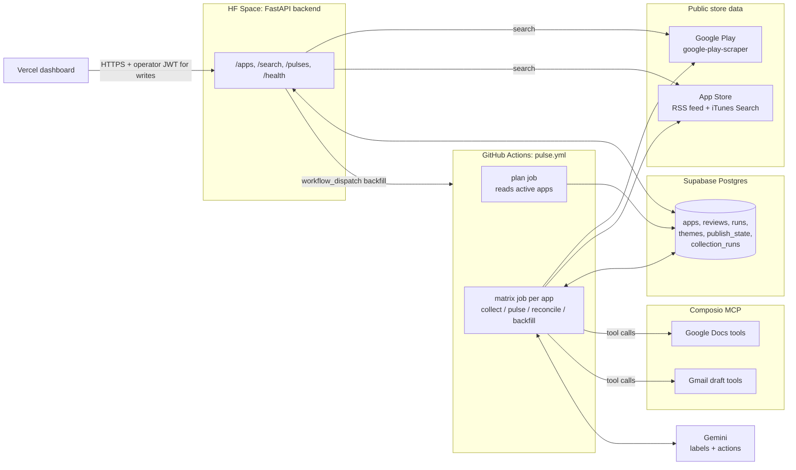
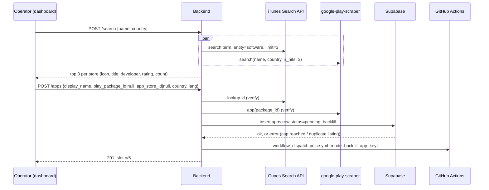

# Architecture v2: Multi-App Weekly Review Pulse

> Companion to `groww-weekly-review-pulse-problem.md` (v2). This document covers what changes from `architecture.md` (v1) to support up to 5 apps, both stores, scheduled collection, Supabase storage, Composio MCP and a per-app dashboard.
> Everything in `architecture.md` not mentioned here still holds: cleaning, PII scrubbing, theme engine, quote extraction, the ≤250-word budget and the fail-closed validation gate. Each now runs **per app**.

**Status:** Draft v2 | **Date:** 2026-11-23

---

## 1. What Changes From v1

| Area | v1 | v2 |
|---|---|---|
| Apps | Groww, hardcoded in `config/pulse.yaml` and prompts | Registry of ≤5 apps in Supabase; Groww is app #1 |
| Sources | Play Store via manual CSV | Play Store + App Store, automated (ADR-9) |
| Cadence | Manual `pulse run` | Backfill on confirm, daily collect, weekly pulse, monthly reconcile (ADR-10) |
| Scheduler | None | One GitHub Actions workflow with a matrix over active apps |
| Store | SQLite `data/pulse.db` | Supabase Postgres in production; SQLite for tests and local runs, behind one interface |
| MCP | Custom `gmail-docs-mcp` server on Vercel | Composio MCP |
| Delivery | One Doc + one draft per week | One Doc + one draft per app per week |
| UI | Single-app pulse viewer | Per-app dashboard with app switcher and Manage Apps |
| Backend code | `src/` copied into `hf_space/src/` | One `src/`; the HF Space is built from it at deploy time |

---

## 2. System Context



**Rule:** only the backend and the Actions jobs talk to Supabase, using the service-role key. The dashboard never holds a Supabase key; it calls the backend.

---

## 3. App Registry and Resolution

### 3.1 Add-app flow



### 3.2 Rules enforced in code or database

| Rule | Enforced by |
|---|---|
| ≤5 apps with `status <> 'archived'` | Postgres trigger `enforce_active_app_cap` on insert and on update of `status` |
| A store listing belongs to at most one non-archived app | Partial unique indexes on `play_package_id` and `app_store_id` where `status <> 'archived'` |
| At least one store listing | `CHECK (play_package_id IS NOT NULL OR app_store_id IS NOT NULL)` |
| `app_key` and store IDs never change | Trigger `freeze_app_identity` rejects updates to `app_key`, `play_package_id`, `app_store_id` |
| Rename | `PATCH /apps/{key}` accepts only `display_name` |
| Replace | `POST /apps/{key}/replace` archives the old app and creates a new one in one transaction |
| Remove | `DELETE /apps/{key}` sets `status='archived'`, `archived_at=now()`; no rows deleted |
| Writes need an operator | Backend verifies a Supabase Auth JWT and checks its email against `OPERATOR_EMAILS` |

`app_key` is a slug of the display name at creation, made unique by suffix (`groww`, `groww-2`).

### 3.3 Implementation notes (Phase 9)
- `src/registry/resolve.py` runs Play search and one iTunes search in parallel with a per-store timeout; a failed or slow store returns `status: error` without blocking the other. Only allowlisted fields leave the resolver.
- The Play search's top hit often has no package ID (RES-10). App Store bundle IDs are tried as Play packages and confirmed with a Play lookup before they are offered.
- Verification by ID is the source of truth: any ID the operator types is accepted if verify succeeds (RES-06). Category comes from the Play genre, else the App Store genre.
- The service pre-checks the cap and duplicate listings to give a clear message naming the owning app; the database triggers and indexes still enforce both.
- Write routes return 503 until `OPERATOR_EMAILS` and a JWT verifier (`SUPABASE_JWT_SECRET` or `SUPABASE_URL` JWKS) are set. `test_AUTH_05_route_auth_table` fails if a route is added without an auth entry.
- Backfill dispatch failures leave the app `pending_backfill`; the response reports `dispatched`, `failed` or `not_configured`.
- `/apps/{key}/pulses/{week}` serves the published `note.md` from `outputs/` when present. Notes are not stored in Supabase yet, so on the Space this field is `null` until Phase 11 persists it.

---

## 4. Collection

### 4.1 Source adapters (`src/ingest/`)

| Adapter | File | Notes |
|---|---|---|
| `PlayStoreSource` | `play_store.py` | `reviews()` newest-first, continuation, stop at window start, ≥1 s sleep between pages |
| `AppStoreSource` | `app_store.py` | RSS JSON pages 1-10, stop at window start; sets `source_limit_hit` when page 10 is reached before the window start |
| `PlayCsvSource` | `play_csv.py` (exists) | Manual path, kept |

All adapters implement `ReviewSource.fetch(app, window) -> Iterator[RawReview]` and map only allowlisted fields (ADR-9 §Rules). Identity fields never reach a `RawReview`.

### 4.2 Modes

| Mode | Window | After collection |
|---|---|---|
| `backfill` | 12 weeks to today | Set `status='active'`, run `pulse` for the latest complete week |
| `daily` | Last 3 days | Nothing |
| `reconcile` | Previous calendar month | Nothing |

Each mode writes one `collection_runs` row per app and store.

---

## 5. Data Architecture (Supabase Postgres)

Migrations live in `supabase/migrations/`. SQLite gets the same schema from `src/store/sqlite_schema.sql` for tests.

```sql
CREATE TABLE apps (
  app_key          TEXT PRIMARY KEY,
  display_name     TEXT NOT NULL,
  play_package_id  TEXT,
  app_store_id     TEXT,
  country          TEXT NOT NULL DEFAULT 'in',
  lang             TEXT NOT NULL DEFAULT 'en',
  category         TEXT,
  status           TEXT NOT NULL CHECK (status IN ('pending_backfill','backfilling','active','archived','failed')),
  created_at       TIMESTAMPTZ NOT NULL DEFAULT now(),
  archived_at      TIMESTAMPTZ,
  CHECK (play_package_id IS NOT NULL OR app_store_id IS NOT NULL)
);
CREATE UNIQUE INDEX apps_play_live  ON apps (play_package_id) WHERE status <> 'archived' AND play_package_id IS NOT NULL;
CREATE UNIQUE INDEX apps_ios_live   ON apps (app_store_id)    WHERE status <> 'archived' AND app_store_id IS NOT NULL;

CREATE TABLE reviews (
  app_key        TEXT NOT NULL REFERENCES apps(app_key),
  review_id      TEXT NOT NULL,
  platform       TEXT NOT NULL CHECK (platform IN ('play_store','app_store')),
  rating         SMALLINT NOT NULL CHECK (rating BETWEEN 1 AND 5),
  title          TEXT,
  text           TEXT NOT NULL,
  review_date    DATE NOT NULL,
  app_version    TEXT,
  lang           TEXT,
  low_info       INTEGER NOT NULL DEFAULT 0,
  pii_found      INTEGER NOT NULL DEFAULT 0,
  quote_eligible INTEGER NOT NULL DEFAULT 1,
  ingested_at    TIMESTAMPTZ NOT NULL DEFAULT now(),
  PRIMARY KEY (app_key, review_id)
);

CREATE TABLE collection_runs (
  collection_id    BIGSERIAL PRIMARY KEY,
  app_key          TEXT NOT NULL REFERENCES apps(app_key),
  platform         TEXT NOT NULL,
  mode             TEXT NOT NULL CHECK (mode IN ('backfill','daily','reconcile','csv_import')),
  window_start     DATE NOT NULL,
  window_end       DATE NOT NULL,
  covered_start    DATE,
  fetched          INTEGER NOT NULL DEFAULT 0,
  inserted         INTEGER NOT NULL DEFAULT 0,
  source_limit_hit INTEGER NOT NULL DEFAULT 0,
  status           TEXT NOT NULL CHECK (status IN ('running','ok','failed','skipped_disabled')),
  error            TEXT,
  started_at       TIMESTAMPTZ NOT NULL DEFAULT now(),
  finished_at      TIMESTAMPTZ
);
```

`runs`, `themes` and `review_themes` keep their v1 columns and gain `app_key TEXT NOT NULL REFERENCES apps(app_key)` as the first part of their keys. `publish_state` becomes:

```sql
CREATE TABLE publish_state (
  app_key      TEXT NOT NULL REFERENCES apps(app_key),
  week_start   DATE NOT NULL,
  doc_id       TEXT,
  doc_url      TEXT,
  draft_id     TEXT,
  content_hash TEXT,
  updated_at   TIMESTAMPTZ,
  PRIMARY KEY (app_key, week_start)
);
```

**Row-level security:** enabled on every table with no policies for `anon` or `authenticated`. Only the service role (backend and Actions) can read or write.

**Store interface:** `src/store/store.py` holds one SQL implementation, `PulseStore`, for app management. `PulseStore.for_app(key)` returns an `AppStore`, and every per-app read and write goes through it, so pipeline code cannot mix apps. `src/store/connectors.py` has two connectors, `SqliteConnector` (tests, local) and `PostgresConnector` (Supabase via `SUPABASE_DB_URL`); both run the same SQL with `?` placeholders. `PULSE_STORE=sqlite|supabase` selects the connector (`src/store/factory.py`). Flags are INTEGER 0/1 and dates are ISO TEXT on both backends so the schemas match column for column (test STO-01). Postgres tests run when `PULSE_TEST_POSTGRES_DSN` is set.

**Retention:** as v1, per app. Archived apps keep their rows.

---

## 6. Scheduling: `.github/workflows/pulse.yml`

```yaml
on:
  schedule:
    - cron: "30 20 * * *"   # daily collect
    - cron: "30 3 * * 1"    # weekly pulse
    - cron: "30 21 1 * *"   # monthly reconcile
  workflow_dispatch:
    inputs:
      mode:    { type: choice, options: [backfill, daily, pulse, reconcile] }
      app_key: { type: string, required: false }

jobs:
  plan:
    outputs: { jobs: ... }   # JSON list of {app_key, mode}, from `python -m src.scheduler plan`
  run:
    needs: plan
    if: needs.plan.outputs.jobs != '[]'
    strategy:
      fail-fast: false
      max-parallel: 2
      matrix:
        include: ${{ fromJSON(needs.plan.outputs.jobs) }}
    concurrency:
      group: pulse-${{ matrix.app_key }}
      cancel-in-progress: false
    steps:
      - checkout, setup-python, install
      - python -m src.scheduler run --app "$APP_KEY" --mode "$JOB_MODE" > job.log 2>&1
      - python -m src.scheduler show-log --app "$APP_KEY" --file job.log
```

| Concern | How |
|---|---|
| Which apps | `python -m src.scheduler plan` reads the registry and emits one `{app_key, mode}` per job. `pulse` and `reconcile` take `active` apps only |
| Pending backfills | In `daily` mode, apps in `pending_backfill` or `backfilling` (a job that died part-way) run `backfill` |
| No overlap per app | `concurrency` group per `app_key`. GitHub keeps one running and one waiting job per group; a third replaces the waiting one, and the next daily run picks that app up again |
| Isolation | `fail-fast: false` |
| Rate limits | `max-parallel: 2` |
| Dispatch from backend | `POST /repos/{owner}/{repo}/actions/workflows/pulse.yml/dispatches` with a fine-grained token scoped to this repository, permission **Actions: write** only |
| 60-day inactivity disable | The repo gets a commit at least every 60 days, or the operator re-enables the workflow; the dashboard health card shows the last successful scheduled run |
| Default branch | GitHub runs schedules and dispatches only for workflows on the default branch, so `pulse.yml` takes effect after the merge to `main` |
| Log privacy | The job's output goes to a file. `show-log` prints it only when it holds no secret, email or stored review text, and withholds it when the store cannot be read. Jobs print statuses and counts; crashes print the exception type and source line only |
| Archive during a run (APP-13) | Status is read again before the Doc write and before the draft write; a job cannot set an archived app back to another status |
| Low volume (COL-08) | Fewer than `note.min_reviews` (30) usable reviews in the window: status `low_volume`, nothing published, job green |
| Parallel migrations | `apply_schema` takes a Postgres advisory lock and records applied files in `pulse_internal.applied_migrations`, so two jobs starting together cannot race |
| Publish secrets | Composio settings and `PULSE_EMAIL_TO` reach the job step only for `pulse` and `backfill` |

Secrets (GitHub Actions): `SUPABASE_DB_URL` (session pooler DSN), `COMPOSIO_API_KEY`, `COMPOSIO_MCP_URL`, `COMPOSIO_GOOGLEDOCS_ACCOUNT_ID`, `COMPOSIO_GMAIL_ACCOUNT_ID`, `PULSE_EMAIL_TO`. No code calls Gemini, so no Gemini key is set.
Secrets (HF Space): `SUPABASE_URL`, `SUPABASE_SERVICE_ROLE_KEY`, `GH_DISPATCH_TOKEN`, `GH_REPO`, `OPERATOR_EMAILS`, `SUPABASE_JWT_SECRET`.

---

## 7. MCP: Composio

### 7.1 Capability map (`config/mcp.yaml`)

The file holds no secrets. URL and keys come from the environment.

| Capability | Composio tool | Notes |
|---|---|---|
| `docs.create` | `GOOGLEDOCS_CREATE_DOCUMENT_MARKDOWN` | `title`, `markdown_text` |
| `docs.get` | `GOOGLEDOCS_GET_DOCUMENT_BY_ID` | Reads body end index before replace |
| `docs.clear` | `GOOGLEDOCS_UPDATE_EXISTING_DOCUMENT` | One `deleteContentRange` from 1 to end-1 |
| `docs.write` | `GOOGLEDOCS_UPDATE_DOCUMENT_SECTION_MARKDOWN` | Append mode after clear |
| `gmail.create_draft` | `GMAIL_CREATE_EMAIL_DRAFT` | `include_signature: false` |
| `gmail.update_draft` | `GMAIL_UPDATE_DRAFT` | `include_signature: false` |

**Denylist:** `GMAIL_SEND_EMAIL`, `GMAIL_SEND_DRAFT`, and any tool slug containing `SEND`, `DELETE` or `TRASH`. The client refuses to call a slug not in the allowlist above.

**Account pinning:** every call passes the configured connected-account ID. More than one Gmail account is connected in Composio, so a call without an explicit account ID is refused by the client.

### 7.2 Publish per app and week

```
state = publish_state[app_key, week_start]
if state.content_hash == hash(note): no-op
elif state.doc_id: docs.get -> docs.clear -> docs.write
else: docs.create -> save doc_id, doc_url
if state.draft_id: gmail.update_draft (if it returns not-found: gmail.create_draft)
else: gmail.create_draft
save draft_id, content_hash
```

Failure handling is unchanged from v1 §10.5, per app.

### 7.2.1 Implementation notes (Phase 10)
- The server is Composio Connect (`https://connect.composio.dev/mcp`): Streamable HTTP JSON-RPC with the consumer key in `x-consumer-api-key`. It returned no session header when probed on 2026-11-23; the client sends one if a server provides it.
- Connect exposes meta tools, not the Docs and Gmail tools. The client sends only `COMPOSIO_MANAGE_CONNECTIONS` with `action: list` and `COMPOSIO_MULTI_EXECUTE_TOOL` with one allowlisted slug and an explicit `account`.
- The server itself is not limited to the six tools: this key can reach every tool Connect offers, so the allowlist in this client is the only tool restriction. A focused Composio MCP server would add a server-side limit.
- Before any write, the client lists connected accounts and resolves both pins by ID or alias. A pin that matches no account, matches two, or is not active stops the publish before the Doc is created.
- Create, clear and append calls are not replayed after an ambiguous failure (MCP-23), since a replay could duplicate a Doc, a draft or text. A rerun rewrites a Doc whose ID is stored. If the reply to a create was lost, its ID is unknown and a rerun creates a second object, so the error says the call may have completed.
- Results are read from `data.results[0].response`. Errors are sorted into connection-expired (CMP-07), not-found (MCP-10, CMP-06) and generic. The error wording markers are assumptions: no real expired or not-found reply has been observed.
- After the Doc step the publisher saves `doc_id` with `content_hash = NULL`; the hash is written only after the draft step succeeds.
- The pipeline builds the client before the run starts, so missing variables fail with no run row (CMP-10). Publish errors mark the run `publish_failed`, keep `note.md`, and put the message in `run_report.json`.
- Limit: a Doc moved to Drive trash may still be readable through the Docs API, in which case it is updated rather than recreated. Not tested live.
- Live check 2026-11-23: one Groww Doc and one unsent draft created for week 2026-11-16; an unchanged rerun made no tool calls; two changed reruns kept both IDs, and reading the Doc and draft back showed one copy of the note.

### 7.3 Retiring `gmail-docs-mcp`

The v1 `config/mcp.yaml` contains a committed bearer token for the `gmail-docs-mcp` server. Phase 7 removes it from the file, and the token must be rotated on that server, since it stays in git history.

---

## 8. Backend API (FastAPI on HF Space)

| Method | Path | Auth | Purpose |
|---|---|---|---|
| GET | `/apps?include_archived=` | none | List apps with status and slot count |
| POST | `/search` | operator | Top 3 matches per store |
| POST | `/apps` | operator | Register confirmed listings, dispatch backfill |
| PATCH | `/apps/{key}` | operator | Rename |
| POST | `/apps/{key}/replace` | operator | Archive + create |
| DELETE | `/apps/{key}` | operator | Archive |
| GET | `/apps/{key}/pulses?limit=` | none | Week list with doc/draft links and theme stats |
| GET | `/apps/{key}/pulses/{week}` | none | Rendered note + themes |
| GET | `/apps/{key}/health` | none | Collection runs, covered window, flags, last scheduled run |

Read endpoints return only data already published in notes (themes, counts, the 3 quotes). Raw review text is never served.

The HF Space free tier sleeps after inactivity; the dashboard shows a "waking backend" state on the first request.

---

## 9. Dashboard (React + Vite + Tailwind on Vercel)

| Route | Content |
|---|---|
| `/` | Redirect to the first active app |
| `/apps/:appKey` | Latest pulse, theme table, theme share trend (last 8 weeks), Doc and draft links, health card |
| `/apps/:appKey/weeks/:week` | One past pulse |
| `/manage` | Slot counter, add flow (search → choose per store → confirm), rename, replace, archive |

The app switcher sits in the header on every route. The selected app is in the URL, so links are shareable. The existing Help/Feature explorer stays and gains entries for the new features.

---

## 10. Repository Layout Changes

```
.github/workflows/pulse.yml        # the one scheduled workflow
supabase/migrations/*.sql          # schema, cap trigger, identity trigger, RLS
src/registry/                      # app registry service + resolution (search, verify)
src/ingest/play_store.py           # automated Play adapter
src/ingest/app_store.py            # App Store RSS adapter
src/store/base.py                  # PulseStore protocol
src/store/sqlite_store.py
src/store/supabase_store.py
src/mcp/composio.py                # Composio MCP client with allowlist + account pinning
src/api/                           # FastAPI app served by the HF Space
hf_space/                          # Space metadata only; no src/ copy (built at deploy)
```

A CI check fails when `hf_space/src/` exists in the repository.

---

## 11. Risks and Mitigations (new in v2)

| Risk | Mitigation |
|---|---|
| `google-play-scraper` breaks after a Play page change | Daily failure shows on dashboard; pinned version; CSV fallback |
| App Store 500-review cap | Daily collection; `source_limit_hit` recorded and shown |
| Wrong app picked at resolution | Mandatory confirmation with icon and developer; verify by ID |
| Scheduled workflows disabled after 60 days without repo activity | Health card shows last scheduled run; documented re-enable step |
| Supabase free project paused | Daily job keeps it active |
| Composio connection expires or wrong account | Account pinning; clear "reconnect in Composio" error; local Markdown fallback |
| 5 apps × Gemini calls hit rate limits | `max-parallel: 2`; retry with backoff; per-app failure isolation |
| Public dashboard writes | Operator JWT + email allowlist on every write endpoint |
| Secrets in repo (v1 token) | Removed and rotated in Phase 7; secret scan in CI |

---

## 12. Key Decisions (v2)

| # | Decision | Alternatives |
|---|---|---|
| ADR-9 | Automated collection from both stores | Manual CSV per app (does not scale) |
| ADR-10 | Backfill + daily + monthly reconcile; weekly pulse | Monthly only (stale weekly pulses, App Store cap loss) |
| ADR-11 | Supabase Postgres as production store, SQLite for tests | Repo file (public, noisy commits); HF dataset (not queryable, no live edits) |
| ADR-12 | One matrix workflow reading the registry at run time | One workflow file per app (needs a repo-write token, edits YAML on every change) |
| ADR-13 | Composio MCP for Docs and Gmail | Keep custom `gmail-docs-mcp` |
| ADR-14 | Confirm-from-top-3 resolution | Auto-pick first match |
| ADR-15 | Store IDs immutable; replace = archive + new app | Editable IDs (mixes histories) |
| ADR-16 | Dashboard reads and writes only through the backend; RLS with no client policies | Supabase anon key in the browser |
